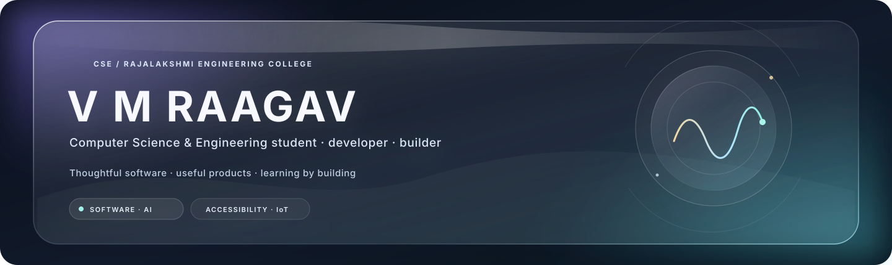

  
   
  <a href="#selected-work">Selected work</a> &nbsp;·&nbsp;
  <a href="#toolkit">Toolkit</a> &nbsp;·&nbsp;
  <a href="#currently-learning">Learning</a> &nbsp;·&nbsp;
  <a href="#connect">Connect</a>

 

## About

I’m **VM Raagav**, a Computer Science & Engineering student at **Rajalakshmi Engineering College, Chennai**. I like building practical software that connects thoughtful user experiences with useful technology—from accessibility and campus tools to applied AI.

| Focus | What I’m working with |
|:--|:--|
| **Core languages** | C · Java · Python · JavaScript |
| **Web & data** | HTML · CSS · Node.js · Express · MySQL · PostgreSQL · Supabase |
| **Build tools** | Git · GitHub · VS Code · Streamlit |
| **Current focus** | DSA · OOP · backend development · problem-solving |

## Selected work

<table>
  <tr>
    <td width="50%" valign="top">
      <h3>🦯 PathAhead</h3>
      
An ESP32-to-iPhone accessibility prototype exploring spoken obstacle awareness through distance sensing, motion data, Bluetooth LE, and ElevenLabs voice cues.

      
<strong>ESP32 · SwiftUI · BLE · HC-SR04 · MPU6050 · ElevenLabs</strong>

      <a href="https://github.com/RAAGAV1218/PathAhead">View project →</a> 
      Early supervised prototype; not a replacement for a cane or mobility training.
    </td>
    <td width="50%" valign="top">
      <h3>🔎 FindIt</h3>
      
A smart campus lost-and-found app for reporting items, browsing listings, and surfacing likely matches based on details such as category, color, place, and description.

      
<strong>Python · Streamlit · Pandas · text similarity</strong>

      <a href="https://findit-6gguozwfarnm7mmpjyu7p6.streamlit.app/">Try the live demo →</a>
    </td>
  </tr>
  <tr>
    <td colspan="2" valign="top">
      <h3>🛡️ Voice-cloning impersonation detection</h3>
      
<strong>Smart India Hackathon 2026 · SIH26104</strong>

      
A cybersecurity concept focused on detecting synthetic-voice impersonation and reducing risks from identity fraud and social engineering.

    </td>
  </tr>
</table>

## Toolkit

  

## Currently learning

  <table>
    <tr>
      <td align="center" width="33%"><strong>Computer science</strong> Data structures · algorithms · OOP</td>
      <td align="center" width="33%"><strong>Software engineering</strong> APIs · backend · full-stack apps</td>
      <td align="center" width="33%"><strong>Building well</strong> Databases · problem-solving · accessible UX</td>
    </tr>
  </table>

## Connect

I’m always glad to meet people building useful things and learn from new perspectives.

[GitHub](https://github.com/RAAGAV1218) &nbsp;·&nbsp; [LinkedIn](https://www.linkedin.com/in/vmraagav)

  Learning in public, one useful build at a time.

